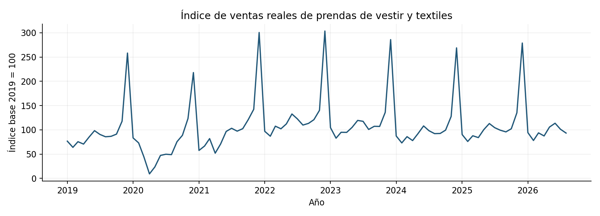
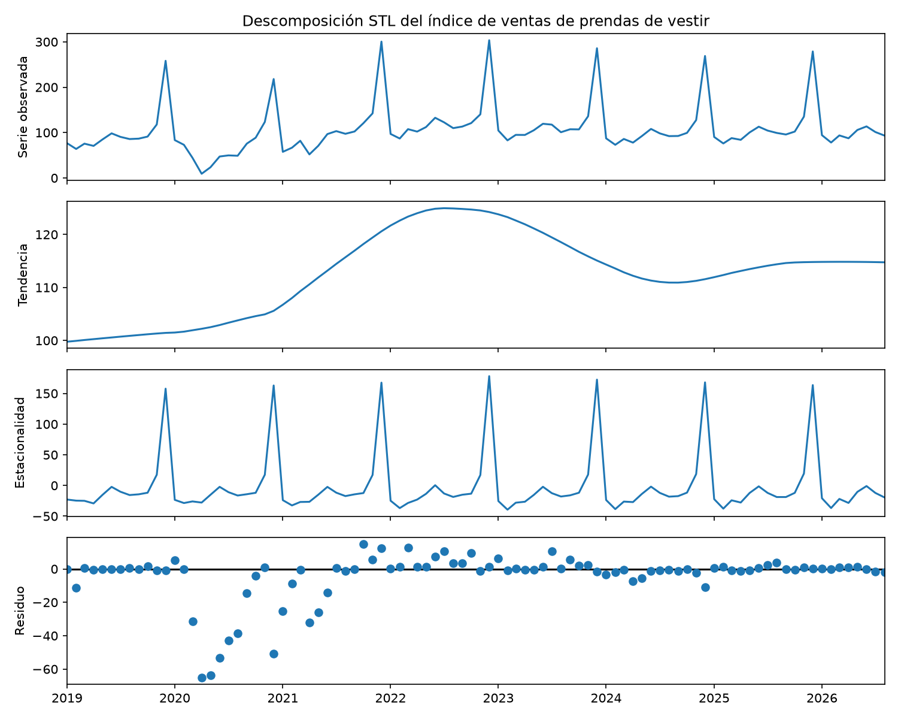
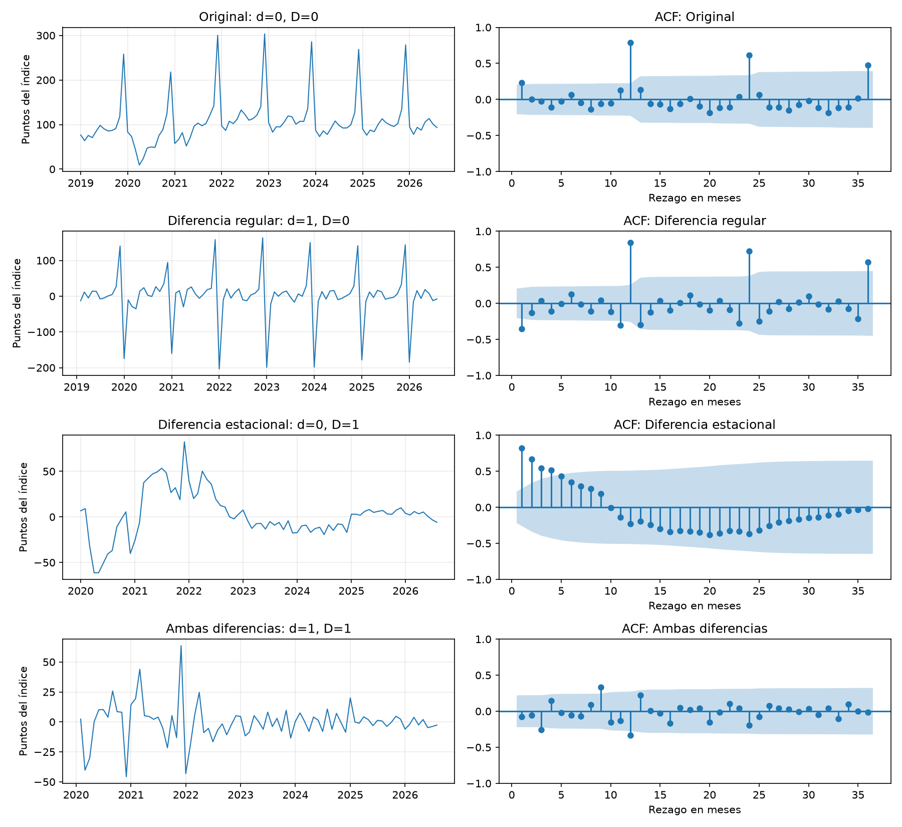
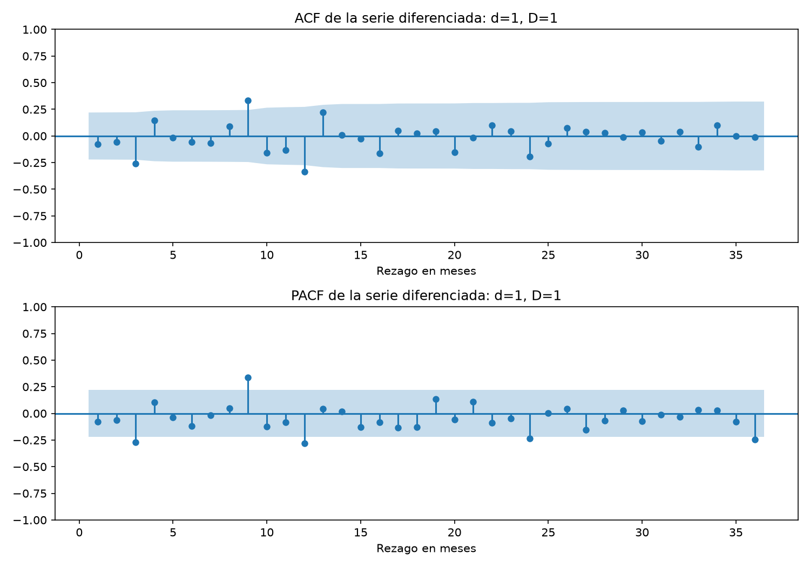
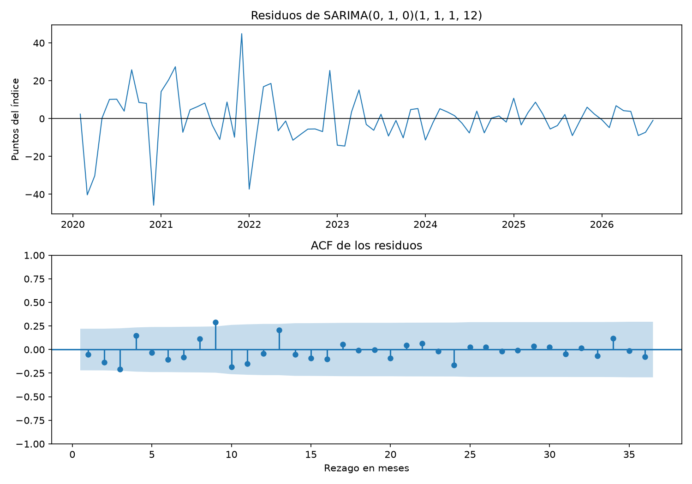
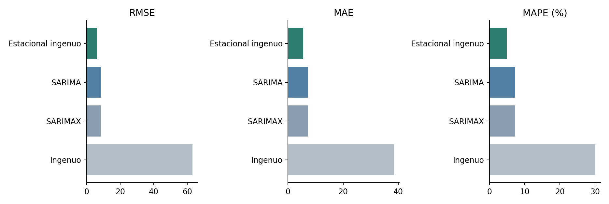
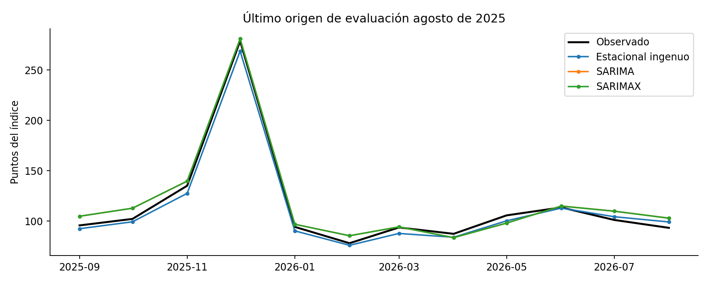

# Informe del miniproyecto 1

**Pronóstico de series temporales con IA — Universidad Autónoma de Occidente, 2026-II**  
**Serie:** índice mensual de ventas reales de prendas de vestir y textiles, total nacional (DANE).  
**Periodo analizado:** enero de 2019 a agosto de 2026.

## 1. La serie

Se analiza el **índice de ventas reales de prendas de vestir y textiles** de la **Encuesta Mensual de Comercio (EMC)** del Departamento Administrativo Nacional de Estadística (DANE). El índice expresa la evolución relativa de las ventas a precios constantes, con **base 2019 = 100**; no equivale a cantidades de prendas ni a ingresos en pesos. Se utilizó la hoja **2.2, «Índices de las ventas en valores reales según grupo de mercancía - Total nacional»**, columna **«4. Prendas de vestir y textiles»**, del archivo `anex-EMC-ComercioMinorista-ago2026.xlsx`.

La serie tiene **frecuencia mensual**, **92 observaciones**, desde **enero de 2019 hasta agosto de 2026**, y un periodo estacional de **12 meses**. Se eligió por ser una fuente pública, tener más de 60 observaciones y presentar un patrón anual pronunciado, en particular máximos recurrentes en diciembre, además de cambios de nivel relevantes para comparar modelos de pronóstico.

- **Fuente:** [DANE — EMC, información histórica](https://www.dane.gov.co/index.php/estadisticas-por-tema/comercio-interno/encuesta-mensual-de-comercio-emc/encuesta-mensual-de-comercio-emc-historicos).
- **Archivo utilizado:** [Anexo EMC, agosto de 2026](https://www.dane.gov.co/files/operaciones/EMC/anex-EMC-ComercioMinorista-ago2026.xlsx).
- **Condiciones de uso:** [Términos y condiciones del DANE](https://www.dane.gov.co/index.php/en/terrminos-y-condiciones-dane). Se permite utilizar y transformar la información reconociendo la fuente, conforme a esas condiciones generales; no se presupone una licencia Creative Commons específica para este anexo.
- **Atribución:** «Fuente: Departamento Administrativo Nacional de Estadística: www.dane.gov.co».

**Preparación y decisión sobre los datos.** El script `preparar_datos.py` lee el Excel original, reconstruye las **etiquetas de año** que aparecen vacías en las filas intermedias mediante `ffill`, convierte los nombres de los meses en fechas y exporta `datos/prendas_vestir.csv` con las columnas `fecha` e `indice_ventas`. Completar las etiquetas del año **no implica imputar índices de ventas**. Se verificaron la continuidad de los 92 meses, la ausencia de fechas duplicadas y la inexistencia de valores faltantes de la variable.

La serie presenta un mínimo de **9,258 puntos en abril de 2020** y un máximo de **303,508 puntos en diciembre de 2022**. La caída excepcional de 2020 se conserva: su coincidencia temporal con la pandemia no constituye, por sí sola, una estimación causal. También se mantienen los picos de diciembre, que son recurrentes y aportan información estacional. **No se imputaron, eliminaron ni sustituyeron valores observados.** La decisión utilizada para la evaluación es:

> Sin huecos: no se imputa. Se conservan todas las observaciones, incluidos los picos estacionales y la caída excepcional de 2020.

## 2. Componentes

Se aplicó una descomposición **STL aditiva robusta**, con `period=12` y `robust=True`:

$$
y_t = T_t + S_t + R_t,
$$

donde $T_t$ es la tendencia, $S_t$ la estacionalidad y $R_t$ el residuo. La tendencia aumenta aproximadamente hasta 2022, disminuye hacia 2024 y posteriormente presenta una recuperación parcial. El ajuste robusto reduce la influencia de valores excepcionales al estimar los componentes, pero **no altera los valores de la serie original**.

Para interpretar los meses altos y bajos se promedió el componente estacional de STL por mes calendario. Estos son **promedios descriptivos en puntos del índice**, no porcentajes ni coeficientes constantes impuestos por STL:

| Mes | Estacionalidad promedio (puntos del índice) |
|---|---:|
| Enero | -23,370 |
| Febrero | -34,361 |
| Marzo | -25,824 |
| Abril | -27,034 |
| Mayo | -13,861 |
| Junio | -1,567 |
| Julio | -11,822 |
| Agosto | -17,789 |
| Septiembre | -15,743 |
| Octubre | -12,115 |
| Noviembre | +17,878 |
| Diciembre | +167,232 |

**Diciembre** se ubica muy por encima de la tendencia, con un aporte estacional promedio de **+167,232 puntos**; **noviembre** también queda por encima (**+17,878**). Los restantes meses tienen promedios por debajo de la tendencia, especialmente **febrero** (**−34,361**). La estacionalidad no es necesariamente idéntica en todos los años.

El **residuo de mayor magnitud absoluta** ocurre en **abril de 2020**: aproximadamente **−65,108 puntos**. Indica que, en ese mes, el valor observado quedó 65,108 puntos por debajo de la suma de tendencia y estacionalidad estimadas. Es un **residuo de descomposición**, no un error de pronóstico fuera de muestra. Los promedios estacionales mensuales y la fecha y el valor del mayor residuo absoluto se calculan e imprimen al ejecutar `python miniproyecto.py`.

## 3. Líneas base y backtest

Se utilizó **sin modificaciones** la función `backtest` de `comun.py`, con una ventana final de `n_prueba=24` meses y **horizonte fijo $H=12$**. Como cada origen necesita doce meses futuros observados para ser evaluado, se obtienen:

$$
N_{\mathrm{orígenes}}=24-12+1=13.
$$

El primer origen corresponde a **agosto de 2024** (entrenamiento: enero de 2019 a agosto de 2024) y pronostica **septiembre de 2024 a agosto de 2025**. El último origen es **agosto de 2025** (entrenamiento: enero de 2019 a agosto de 2025) y pronostica **septiembre de 2025 a agosto de 2026**. La ventana de meses evaluables abarca, por tanto, **septiembre de 2024 a agosto de 2026**. Se realizan **$13\times12=156$ comparaciones por modelo**, con ventanas superpuestas; no son 156 meses distintos ni observaciones independientes.

El entrenamiento es **expansivo**: comienza siempre en enero de 2019 y se amplía un mes en cada origen. En el ajuste de cada origen solo se utilizan ventas observadas **hasta ese momento**, evitando introducir ventas futuras. Para SARIMAX se permite usar variables futuras **conocidas de antemano**, como un calendario de festivos. **Limitación:** la elección inicial de $d$, $D$ y de los órdenes SARIMA por AIC se hizo usando la serie completa; por ello la selección de estructura sí incorpora información del intervalo de evaluación y los resultados deben considerarse **exploratorios**, no una validación estrictamente anidada.

Las métricas calculadas en cada origen, sobre $H=12$ pronósticos, son:

$$
\mathrm{MAE}=\frac{1}{H}\sum_{j=1}^{H}|y_j-\hat y_j|,
$$

$$
\mathrm{RMSE}=\sqrt{\frac{1}{H}\sum_{j=1}^{H}(y_j-\hat y_j)^2},
$$

$$
\mathrm{MAPE}=\frac{100}{H}\sum_{j=1}^{H}\left|\frac{y_j-\hat y_j}{y_j}\right|.
$$

Luego se **promedia cada métrica entre los 13 orígenes**. En particular, el RMSE publicado es el promedio de los RMSE de origen, no el RMSE de los 156 errores agrupados. RMSE y MAE se expresan en puntos del índice y MAPE en porcentaje.

| Línea base | RMSE | MAE | MAPE (%) |
|---|---:|---:|---:|
| Ingenuo | 63,08 | 38,41 | 30,10 |
| **Estacional ingenuo** | **6,26** | **5,54** | **4,87** |

El **ingenuo** repite el último valor disponible del entrenamiento durante los doce meses siguientes. El **estacional ingenuo** repite los valores de los mismos meses del año anterior. **Gana el estacional ingenuo en las tres métricas**, lo que demuestra la utilidad de incorporar el patrón anual en esta ventana de evaluación. El MAPE de 4,87 % no debe presentarse como «95,13 % de exactitud».

## 4. Estacionariedad e identificación

Se aplicó la prueba **Augmented Dickey–Fuller (ADF)**, cuya hipótesis nula es la presencia de raíz unitaria. En la serie original se incluyeron constante y tendencia (`regression="ct"`); en las series diferenciadas se incluyó constante (`regression="c"`). Los rezagos se seleccionaron mediante AIC.

| Serie evaluada | $d$ | $D$ | Observaciones | Valor p ADF | Rezagos |
|---|---:|---:|---:|---:|---:|
| Original | 0 | 0 | 92 | 0,590762 | 12 |
| Diferencia regular | 1 | 0 | 91 | 0,113224 | 11 |
| Diferencia estacional | 0 | 1 | 80 | 0,139772 | 12 |
| Ambas diferencias | 1 | 1 | 79 | 0,100338 | 11 |

Con un nivel de significancia de **5 %**, **ninguna versión permite rechazar la hipótesis nula**. Por tanto, no se afirma que la estacionariedad haya quedado demostrada. Considerando conjuntamente el patrón anual, los gráficos y la persistencia de las autocorrelaciones, se eligieron **provisionalmente $d=1$ y $D=1$**, con periodo estacional $s=12$:

$$
w_t=(1-B)(1-B^{12})y_t
    =y_t-y_{t-1}-y_{t-12}+y_{t-13}.
$$

La diferencia regular elimina una observación inicial y la estacional elimina doce; su combinación deja **79 valores**. Estos valores iniciales indefinidos son efecto matemático de diferenciar, no faltantes originales.

La figura compara la serie original, la diferencia regular, la diferencia
estacional y ambas diferencias, junto con sus autocorrelaciones. La
combinación de diferencias reduce visualmente la persistencia, aunque
la prueba ADF no permite confirmar estacionariedad al 5 %.

Sobre la serie con ambas diferencias se analizaron la **ACF y la PACF hasta 36 rezagos** (PACF con `method="ywm"`). En la verificación numérica aparecen picos fuera de las bandas aproximadas del 95 % en:

- **ACF:** rezagos **3, 9 y 12**.
- **PACF:** rezagos **3, 9, 12, 24 y 36**.

El rezago **12** respalda considerar términos estacionales. Sin embargo, no se observa un corte nítido que determine de manera única los órdenes autorregresivos o de medias móviles. Se decidió explorar una rejilla parsimoniosa con $p,q,P,Q\in\{0,1\}$, manteniendo $d=D=1$ y $s=12$. Esa rejilla no modela explícitamente todas las dependencias sugeridas por los picos de 3 y 9 meses. Las bandas son aproximaciones individuales y su superación no prueba causalidad.

## 5. Modelos clásicos

### Rejilla SARIMA y selección por AIC

Se ajustaron **16 modelos SARIMA**, correspondientes a $p,q,P,Q\in\{0,1\}$, con $d=D=1$, $s=12$ y sin tendencia determinista (`trend="n"`). El modelo recibió la **serie original preparada**, ya que las diferencias se aplican internamente. Los ajustes convergieron, pero la convergencia por sí sola no garantiza un diagnóstico adecuado.

| Orden $(p,d,q)$ | Orden estacional $(P,D,Q,12)$ | AIC |
|---|---|---:|
| (0,1,0) | (1,1,1,12) | **632,719** |
| (0,1,0) | (0,1,1,12) | 632,936 |
| (1,1,1) | (0,1,1,12) | 633,122 |
| (1,1,1) | (1,1,1,12) | 633,228 |
| (0,1,1) | (1,1,1,12) | 634,289 |
| (1,1,0) | (1,1,1,12) | 634,443 |
| (0,1,1) | (0,1,1,12) | 634,449 |
| (1,1,0) | (0,1,1,12) | 634,654 |
| (0,1,0) | (1,1,0,12) | 646,293 |
| (1,1,1) | (1,1,0,12) | 647,209 |
| (0,1,1) | (1,1,0,12) | 647,626 |
| (1,1,0) | (1,1,0,12) | 647,832 |
| (1,1,1) | (0,1,0,12) | 654,806 |
| (0,1,0) | (0,1,0,12) | 655,999 |
| (0,1,1) | (0,1,0,12) | 657,427 |
| (1,1,0) | (0,1,0,12) | 657,523 |

El criterio de información de Akaike es:

$$
\mathrm{AIC}=-2\log(L)+2k.
$$

Se eligió **SARIMA$(0,1,0)(1,1,1)_{12}$**, con **AIC = 632,719**, el menor de la rejilla. La alternativa SARIMA$(0,1,0)(0,1,1)_{12}$ obtuvo 632,936; la diferencia de **0,217** es pequeña y no implica superioridad concluyente del primero. El AIC compara ajuste penalizado por complejidad, **no** error predictivo fuera de muestra.

La ecuación del modelo elegido, con $B$ como operador de rezago y $\varepsilon_t$ como innovación, es:

$$
(1-\Phi B^{12})(1-B)(1-B^{12})y_t
=(1+\Theta B^{12})\varepsilon_t.
$$

En la reproducción del ajuste completo se obtuvieron $\Phi\approx0,181652$, $\Theta\approx-0,999776$ y $\sigma^2\approx125,856801$; por tanto:

$$
(1-0,181652B^{12})(1-B)(1-B^{12})y_t
\approx(1-0,999776B^{12})\varepsilon_t.
$$

El coeficiente MA estacional cercano a **−1** está próximo a la frontera de invertibilidad y aconseja revisar en el futuro la necesidad de $D=1$. **No prueba por sí solo una sobrediferenciación.** Los coeficientes detallados proceden de la verificación reproducida y no deben confundirse con salidas adicionales ya incorporadas al guion del grupo.

### Diagnóstico de los residuos

Se revisaron los residuos del ajuste histórico y su ACF, excluyendo los primeros 13 meses asociados a la inicialización. La prueba **Ljung–Box**, con `model_df=2` por los términos AR y MA estacionales, produjo:

| Rezago | Estadístico Ljung–Box | Valor p | Resultado al 5 % |
|---|---:|---:|---|
| 12 | 23,151039 | 0,010203 | Se rechaza ausencia conjunta de autocorrelación |
| 24 | 34,360534 | 0,045129 | Se rechaza ausencia conjunta de autocorrelación |

En ambos rezagos $p<0,05$, por lo que los residuos **conservan dependencia temporal no explicada** y el diagnóstico no es plenamente satisfactorio. La gráfica muestra residuos más amplios en los primeros años, particularmente alrededor de 2020–2022, y menor dispersión reciente. Entre los mayores residuos reproducidos figuran diciembre de 2020 (**−45,762** puntos) y diciembre de 2021 (**+44,865** puntos). No se realizaron pruebas formales que permitan asegurar normalidad u homocedasticidad.

### SARIMAX y variable exógena

Como exógena se utilizó el **número mensual de festivos nacionales de Colombia**, calculado con la biblioteca `holidays`. Se contaron las fechas reconocidas como festivas, incluso si caen en fin de semana: no equivale a días hábiles ni mide directamente el consumo. Esta variable se eligió porque el calendario es **conocido de antemano**, incluidos los periodos de pronóstico; se construyeron **104 meses** desde enero de 2019 hasta agosto de 2027.

El SARIMAX conserva los mismos órdenes $ (0,1,0)(1,1,1)_{12} $ y añade una regresión sobre la exógena, con errores de estructura SARIMA:

$$
y_t=\beta x_t+u_t,\qquad
(1-\Phi B^{12})(1-B)(1-B^{12})u_t
=(1+\Theta B^{12})\varepsilon_t.
$$

Los parámetros se reestiman en cada origen, utilizando únicamente los festivos históricos del entrenamiento y los futuros correspondientes al horizonte. Frente al **SARIMA sin exógena** (RMSE **8,54**, MAE **7,30**, MAPE **7,29 %**), el **SARIMAX con festivos** obtuvo RMSE **8,56**, MAE **7,31** y MAPE **7,30 %**. **No mejoró ninguna de las tres métricas** en este experimento. Esta comparación no demuestra que los festivos carezcan de utilidad en otros periodos o modelos ni establece una relación causal.

## 6. Tabla de métricas

La siguiente tabla reproduce los resultados finales de `resultados/metricas.csv`, **ordenados de menor a mayor RMSE**. La columna de decisión documenta el tratamiento aplicado a la serie.

| Modelo | Decisión | RMSE | MAE | MAPE (%) |
|---|---|---:|---:|---:|
| Estacional ingenuo | Sin huecos: no se imputa. Se conservan todas las observaciones, incluidos los picos estacionales y la caída excepcional de 2020. | **6,26** | **5,54** | **4,87** |
| SARIMA(0,1,0)(1,1,1,12) | Sin huecos: no se imputa. Se conservan todas las observaciones, incluidos los picos estacionales y la caída excepcional de 2020. | 8,54 | 7,30 | 7,29 |
| SARIMAX(0,1,0)(1,1,1,12) + exógenas | Sin huecos: no se imputa. Se conservan todas las observaciones, incluidos los picos estacionales y la caída excepcional de 2020. | 8,56 | 7,31 | 7,30 |
| Ingenuo | Sin huecos: no se imputa. Se conservan todas las observaciones, incluidos los picos estacionales y la caída excepcional de 2020. | 63,08 | 38,41 | 30,10 |

*RMSE y MAE están expresados en puntos del índice; MAPE está expresado en porcentaje. Los valores se muestran con dos decimales, tal como se reportaron en la ejecución final compartida.*

El estacional ingenuo obtuvo los menores errores en las tres métricas.
SARIMA y SARIMAX presentaron resultados muy similares, sin superar
la línea base estacional. El modelo ingenuo registró los mayores errores.

## 7. Conclusión

Entre los **modelos clásicos ajustados**, el mejor fue **SARIMA$(0,1,0)(1,1,1)_{12}$**: RMSE **8,54**, MAE **7,30** y MAPE **7,29 %**. No obstante, **no superó la mejor línea base**, el **estacional ingenuo**, que obtuvo RMSE **6,26**, MAE **5,54** y MAPE **4,87 %**.

Frente a esa línea base, SARIMA **aumentó** el RMSE en **2,28 puntos del índice**, el MAE en **1,76 puntos del índice** y el MAPE en **2,42 puntos porcentuales**. Esto equivale aproximadamente a **36,4 % más RMSE** y **31,8 % más MAE** tomando como denominador el error de la línea base. **No hubo mejora predictiva** con SARIMA ni con SARIMAX en el protocolo utilizado. La incorporación del conteo de festivos fue ligeramente desfavorable respecto al SARIMA sin exógena.

La reproducción de errores por fecha identifica dificultades para el estacional ingenuo en **diciembre de 2024** (error absoluto **17,024** puntos; sobreestimación), **septiembre de 2024** (**14,776**; sobreestimación), **diciembre de 2025** (**9,987**; subestimación) y **noviembre de 2024** (**8,398**; sobreestimación). Aunque sigue el patrón anual, no anticipa completamente los cambios en la amplitud de los máximos estacionales. Para SARIMA, los mayores errores absolutos medios por fecha de la reproducción se presentan en **mayo de 2025** (**15,339**), **abril de 2025** (**14,457**), **junio de 2025** (**9,999**) y **agosto de 2026** (**9,606**); en abril y mayo de 2025 predomina la subestimación. Estos resúmenes por fecha pueden mezclar distintos horizontes y números de evaluaciones, de modo que no representan muestras independientes equivalentes.

La figura presenta los doce pronósticos realizados con entrenamiento
hasta agosto de 2025, frente a los valores observados de septiembre
de 2025 a agosto de 2026. Los modelos reproducen el máximo estacional
de diciembre, aunque presentan diferencias respecto a los valores
observados. Los pronósticos de SARIMA y SARIMAX quedan prácticamente
superpuestos.

Esta figura ilustra un solo origen. La clasificación final de los
modelos se basa en las métricas promedio de los trece orígenes del
backtest.

El resultado principal es que **un método sencillo que respeta la estacionalidad anual superó a los modelos clásicos ensayados**. La comparación está limitada por la ventana reciente de evaluación, la superposición de orígenes, la selección de órdenes usando la serie completa antes del backtest, la rejilla acotada y la **autocorrelación residual** detectada por Ljung–Box. Además, ADF no permitió confirmar estacionariedad al 5 % y el coeficiente MA estacional quedó cerca de la frontera de invertibilidad. Estos hallazgos justifican revisar las diferencias, ampliar prudentemente las especificaciones y separar más estrictamente selección y evaluación en trabajos posteriores.

Por consiguiente, **el estacional ingenuo es la referencia que deberá superar el miniproyecto 2**, bajo un protocolo de comparación equivalente: **RMSE 6,26; MAE 5,54; MAPE 4,87 %**. Esta elección responde al menor error medido, no a la complejidad de los modelos.
